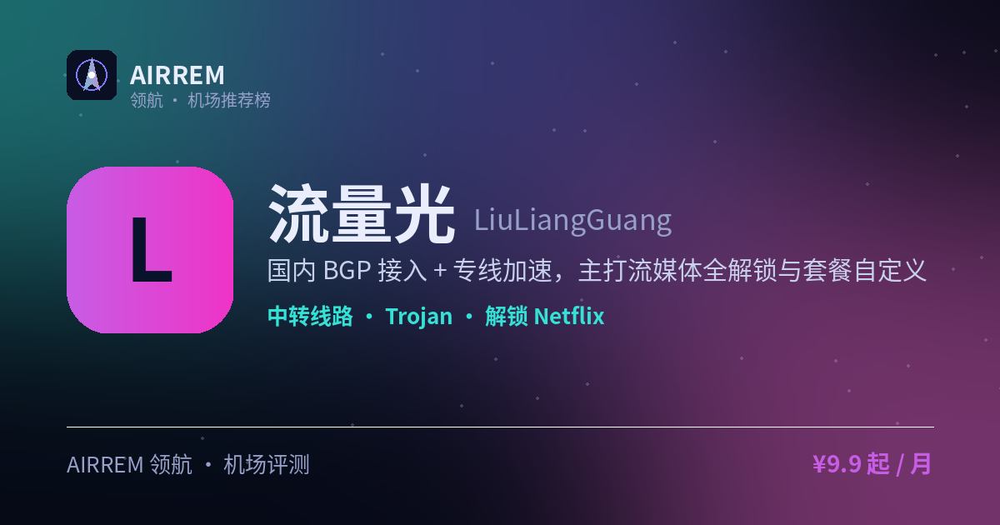

# 流量光机场评测 2026：流媒体重度，官网注册入口与套餐价格

> 国内 BGP 接入 + 专线加速，主打流媒体全解锁与套餐自定义
>
> 最适合：**流媒体重度**。

👉 **[流量光 官网注册入口](https://s.rtxk.us/s/6pqsn8c)** ｜ [完整评测与横向对比](https://555736.xyz/llguang/)

---

## 基本信息

| 项目 | 内容 |
| --- | --- |
| 机场名称 | 流量光 |
| 成立时间 |  |
| 线路类型 | BGP 中转 + 专线可选 |
| 支持协议 | Trojan / Shadowsocks |
| 流媒体解锁 | Netflix / Disney+ / HBO / Spotify / TikTok / ChatGPT |
| 节点地区 | 主流地区 + 含冷门国家（以官网为准） |
| 计费方式 | 包月 / 自定义 |
| 起步价格 | ¥9.9 / 月 |
| 推荐场景 | Netflix/Disney+/HBO 等全解锁重度用户 |

## 优点与缺点

**✅ 优点**

- 流媒体+ChatGPT 解锁范围较全
- 含冷门国家节点
- 支持套餐/规则集自定义
- 无需额外订阅转换

**⚠️ 缺点**

- 定位偏中高价位，预算有限需权衡
- 机场行业存在跑路风险，建议先用月付或小额套餐验证稳定性，别一上来就大额年付。

## 流量光是什么

流量光定位主打稳定体验的机场，国内 BGP 服务器接入并搭配专线加速，节点数量较多且含部分冷门国家节点，支持套餐流量、设备数量与规则集自定义。

## 线路 · 协议 · 解锁

含 IEPL/IPLC 及三网专线选项，节点覆盖主流+冷门；支持 Trojan、SS 与 UDP，官方称解锁 Netflix、Disney+、HBO、Spotify、B 站港澳台、TikTok 及 ChatGPT，部分为原生解锁。

- BGP 接入 + 专线可选
- 含冷门国家节点
- 支持套餐/规则集自定义

> 💡 网络流传的按 G 报价可能已过时，价格以官网为准。

## 流量光 套餐价格

| 套餐 | 价格 | 说明 |
| --- | --- | --- |
| 体验 | ¥9.9 | 150GB/月 |
| 高级 | ¥19.9 | 300GB/月 |
| 豪华 | ¥29.9 | 500GB/月 |
| 年付 Pro | ¥80/年 | 150GB/月，月均约 ¥6.7 |

> 价格取自官网价目，以官网为准。

## 常见问题

**Q：价格多少？**

A：网上报价多为过往信息，请直接看官网当前套餐。

**Q：支持哪些解锁？**

A：官方称解锁 Netflix/Disney+/HBO/Spotify/B站港澳台/TikTok/ChatGPT，建议实测确认。

## 适合谁 / 不适合谁

| 👍 适合 | 👎 不适合 |
| --- | --- |
| 要多平台流媒体全解锁 | 预算很有限、只需基础解锁的轻度用户 |
| 要自定义流量/设备数的重度用户 |  |

## 我们的结论

节点多、解锁范围覆盖主流流媒体与 ChatGPT，支持流量/设备自定义，灵活性好；定位偏中高价位，先月付验证晚高峰再买大额。

## 同类机场推荐

拿不定主意？可以再看看这几家同类型的：

- **[守候](https://555736.xyz/shouhou/)** — 稳健老用户 / Emby 影音，¥15 起
- **[自由猫](https://555736.xyz/freecat/)** — 日常主力，¥6 起
- **[淘气兔](https://555736.xyz/taoqitu/)** — 联通移动用户，¥7.8 起

全部 38 家机场的横向对比与选购方法论：**[信号塔 SignalTower · 机场大全](https://555736.xyz/airports/)**

---

数据更新：2026-07 ｜ 价格、套餐与优惠码以官网实时为准 ｜ 本仓库为第三方评测整理，与 流量光 官方无隶属关系 ｜ 请遵守当地法律法规使用网络服务。

关键词：流量光、流媒体解锁机场、BGP中转、Trojan机场、机场推荐
